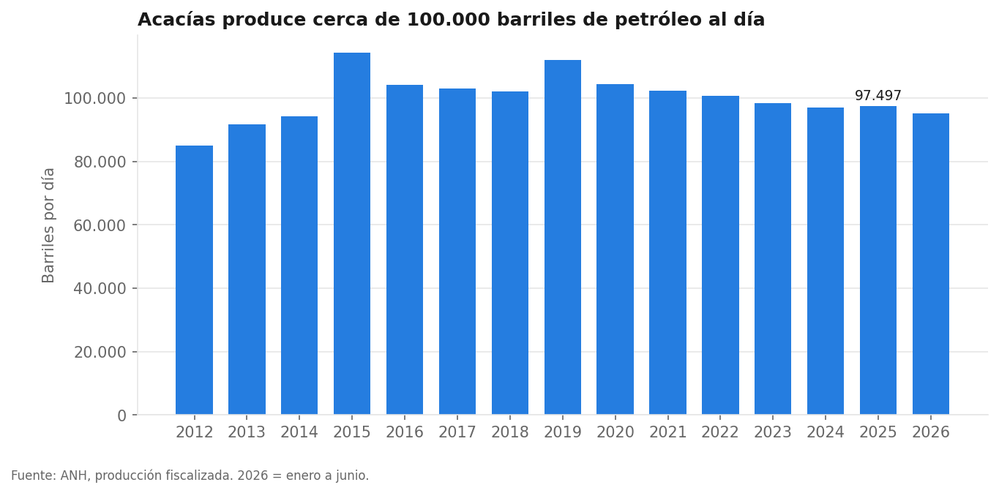
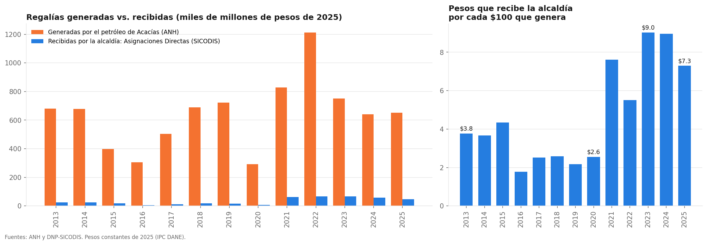
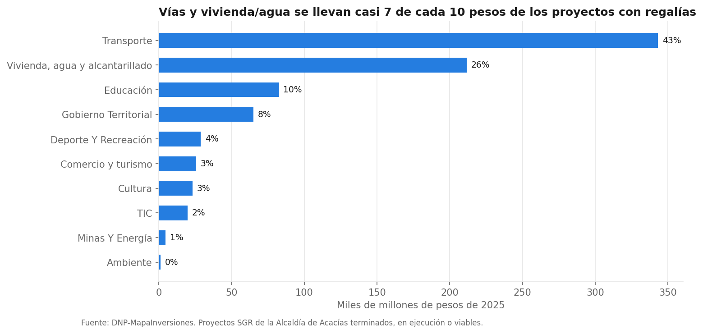
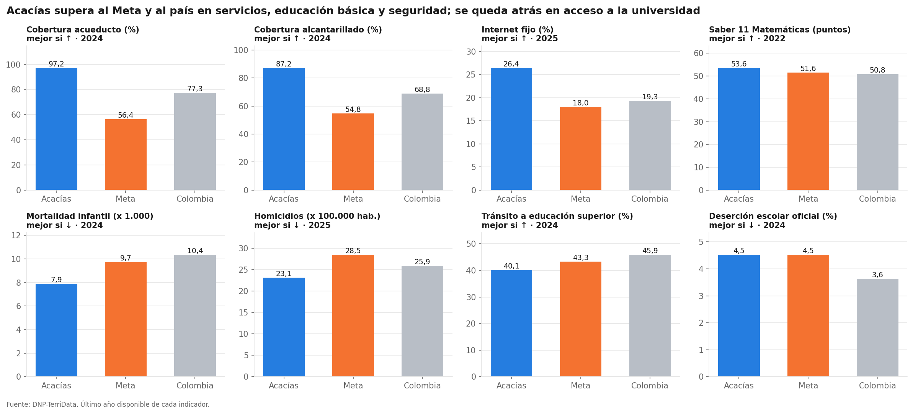
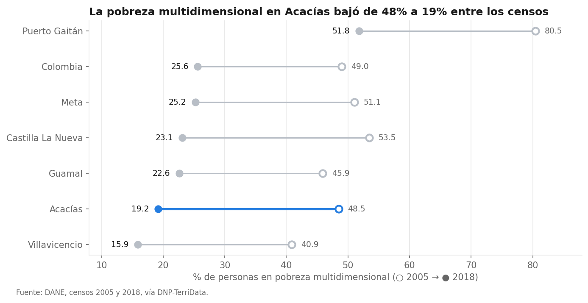
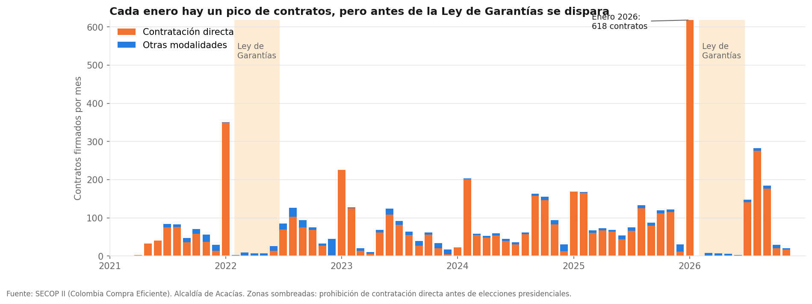

# ¿Acacías vive del petróleo? Regalías vs. desarrollo (2012-2026)

Proyecto de análisis de datos sobre **Acacías, Meta (Colombia)**, el segundo municipio productor de petróleo del departamento. La pregunta: **¿la producción petrolera y las regalías se tradujeron en mejores condiciones de vida para sus habitantes?**

Se cruzan seis fuentes públicas: producción y regalías (ANH), regalías recibidas (DNP-SICODIS), proyectos de inversión (DNP-MapaInversiones), indicadores sociales (DNP-TerriData), contratos (SECOP II) e inflación (DANE).

## Hallazgos principales

**1. Acacías produce cerca de 100.000 barriles de petróleo al día.**



**2. Pero la alcaldía recibe entre $2 y $9 por cada $100 de regalías que genera.** Entre 2013 y 2025 se generaron unos 8,4 billones de pesos (de 2025) en regalías y la alcaldía recibió cerca de 430 mil millones en Asignaciones Directas.



**3. Lo que llega se invierte sobre todo en vías, vivienda y agua.**



**4. Acacías supera al Meta y al país en servicios, educación básica y seguridad, pero se queda atrás en acceso a la universidad.**



**5. La pobreza multidimensional bajó de 48% a 19% entre los censos de 2005 y 2018.**



**6. La contratación sigue el calendario electoral:** el pico de enero se multiplica justo antes de la Ley de Garantías.



## Estructura

```
├── data/                  # datos crudos (no se suben al repositorio, ver abajo)
│   ├── anh/               # Producción y Regalías x Campo, Meta, 2012-2026
│   ├── sicodis/           # PBC vs Recaudo - Asignaciones Directas, 2013-2026
│   ├── sgr plan de recursos/
│   ├── proyectos_sgr/     # MapaInversiones: Datos Básicos + Localización
│   ├── terridata/         # TerriData, descarga por dimensión (TXT)
│   ├── secop contratos/   # SECOP II - Contratos Electrónicos
│   └── ipc/               # DANE, índices IPC series de empalme
├── data processed/        # tablas limpias generadas por los notebooks
├── figuras/               # gráficas finales
└── notebooks/
    ├── 01_limpieza_anh.ipynb
    ├── 02_limpieza_sicodis.ipynb
    ├── 03_ipc_pesos_constantes.ipynb
    ├── 04_proyectos_inversion.ipynb
    ├── 05_terridata_indicadores.ipynb
    ├── 06_secop_contratacion.ipynb
    └── 07_analisis_final.ipynb
```

## Cómo reproducirlo

1. Instala las dependencias: `pip install -r requirements.txt`
2. Descarga los datos crudos de las fuentes (ver `fuentes.md`) en las carpetas de `data/`.
3. Corre los notebooks **en orden**, del 01 al 07, desde la carpeta `notebooks/`.

## Decisiones de limpieza destacadas

- **ANH:** un mismo volumen aparece repetido por cada régimen de regalías; sumarlo directo sobrecuenta un 6% de barriles. Validado contra la cifra publicada de Chichimene en julio de 2025 (37.227 barriles/día).
- **SICODIS:** encabezados en dos filas, columnas que cambian de formato en 2021 (20% + 5%) y filas de ajuste por decreto. Validado contra el total del Excel original.
- **IPC:** todo en pesos constantes de 2025. Validado con la inflación oficial de 2022 (13,12%).
- **TerriData:** archivos de hasta 1 GB leídos por pedazos; mediciones repetidas en el mismo año.
- **SECOP:** columnas con datos personales descartadas y personas naturales anonimizadas.

## Limitaciones

- Correlación no es causalidad: que un indicador mejore mientras llegan regalías no prueba que las regalías lo causaron.
- "Recibidas" incluye solo las Asignaciones Directas; no se cuantificó la inversión de la Gobernación dentro del municipio.
- Algunos indicadores cambian de metodología (vacunación 2021, mortalidad infantil 2017).
- SECOP II cubre a la alcaldía solo desde 2021.

## Herramientas

Python · pandas · matplotlib · Jupyter
