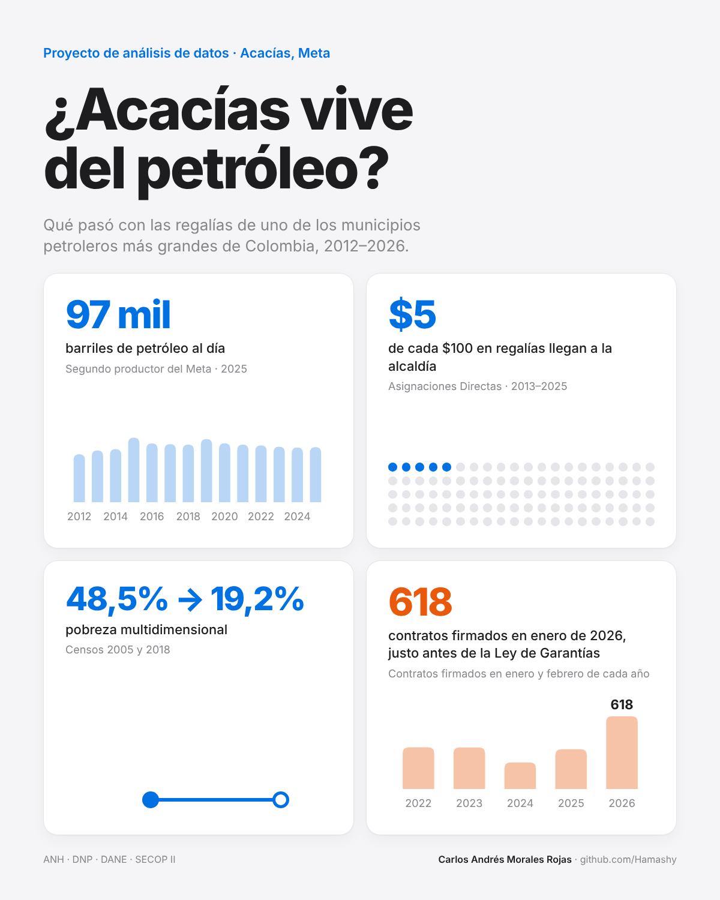
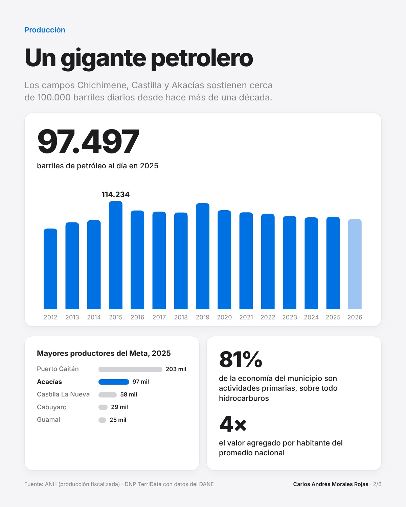
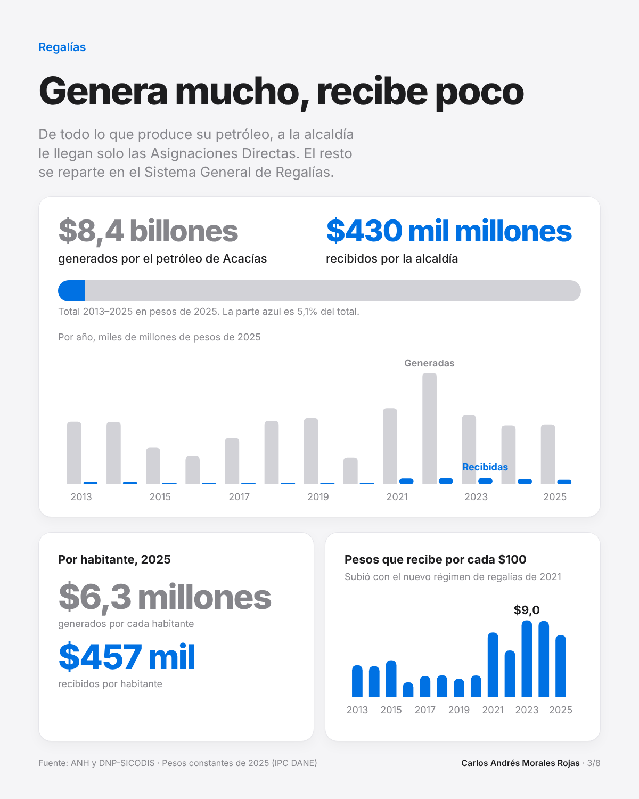
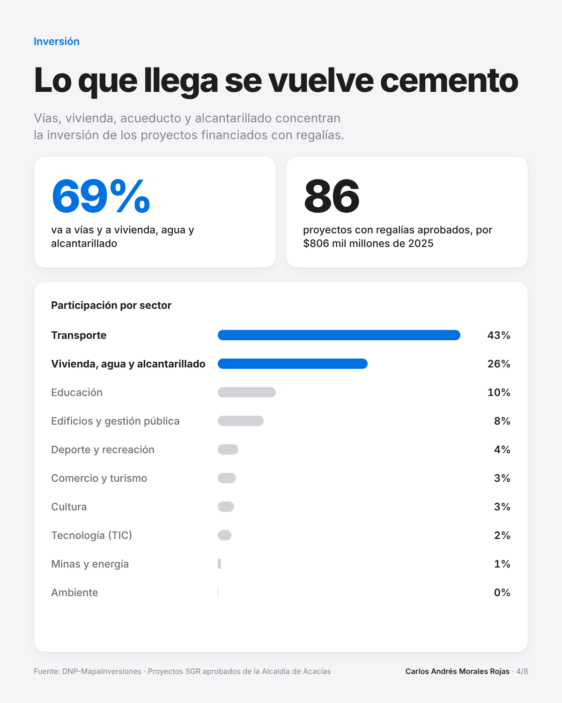
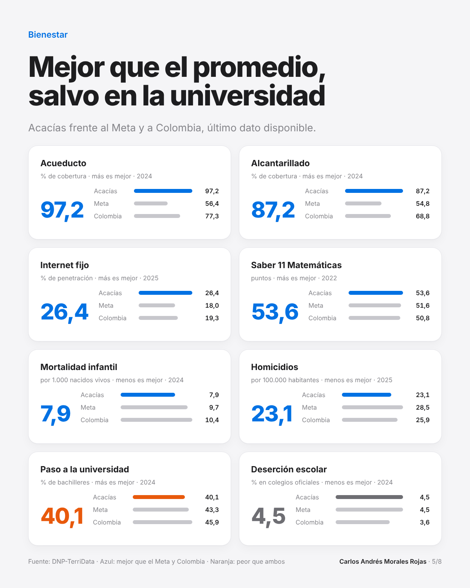
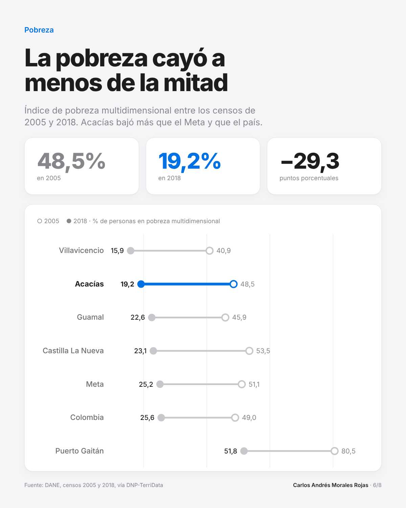
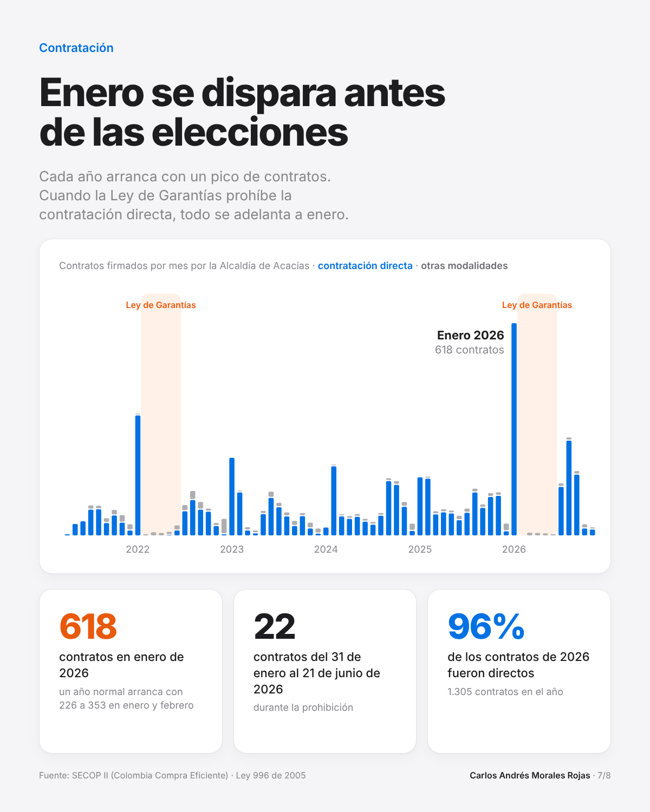
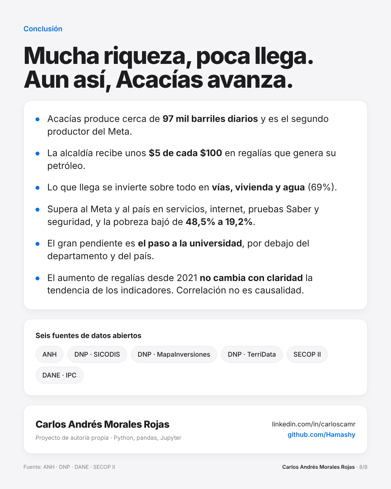

<div align="center">

# ¿Acacías vive del petróleo?

**Regalías vs. desarrollo en un municipio petrolero de Colombia · 2012–2026**

Un proyecto de análisis de datos de **[Carlos Andrés Morales Rojas](https://www.linkedin.com/in/carloscamr/)**


</div>

<br>

<p align="center"></p>

<br>

Acacías, en el Meta, produce cerca de **100.000 barriles de petróleo al día**. Este proyecto cruza seis fuentes de datos públicos para responder una pregunta sencilla: **¿esa riqueza se tradujo en una mejor vida para sus habitantes?**

<br>

## La historia en seis gráficas

### 1 · Un gigante petrolero

Acacías es el **segundo municipio productor del Meta**, después de Puerto Gaitán. Sus campos (Chichimene, Castilla y Akacías) sostienen una producción estable desde hace más de una década.

<p align="center"></p>

### 2 · Genera mucho, recibe poco

Entre 2013 y 2025 el petróleo de Acacías generó cerca de **8,4 billones de pesos** en regalías. La alcaldía recibió unos **430 mil millones**: alrededor de **$5 de cada $100**. El resto se reparte en el Sistema General de Regalías entre fondos regionales, el departamento y el ahorro.

<p align="center"></p>

### 3 · Lo que llega se convierte en cemento

Casi **7 de cada 10 pesos** de los proyectos financiados con regalías se fueron a vías, vivienda, acueducto y alcantarillado.

<p align="center"></p>

### 4 · Mejor que el promedio, salvo en la universidad

Acacías supera al Meta y a Colombia en servicios públicos, internet, pruebas Saber y seguridad. Pero solo **4 de cada 10 bachilleres** pasan directo a la educación superior, por debajo del departamento y del país.

<p align="center"></p>

### 5 · La pobreza cayó a menos de la mitad

Entre los censos de 2005 y 2018, la pobreza multidimensional en Acacías pasó de **48% a 19%**, una caída mayor que la del Meta y la del país.

<p align="center"></p>

### 6 · La contratación sigue el calendario electoral

Cada año arranca con un pico de contratos en enero y febrero (entre 226 y 353 en los años normales). En 2026, la Ley de Garantías prohibió la contratación directa desde el 31 de enero, y todo se adelantó: **618 contratos solo en enero**.

<p align="center"></p>

<br>

## Conclusión

<p align="center"></p>

Acacías produce una enorme riqueza petrolera, pero **solo una fracción pequeña llega a la alcaldía**. Aun así, el municipio está mejor que el promedio en casi todos los indicadores y redujo la pobreza de forma notable. Lo que **no se ve con claridad** es que el aumento de regalías desde 2021 haya cambiado la tendencia de los indicadores, y el acceso a la universidad sigue siendo su punto débil.

<br>

## Cómo se hizo

<details>
<summary><b>Fuentes de datos</b></summary>
<br>

| Fuente | Qué aporta |
|---|---|
| **ANH** | Producción de petróleo y regalías generadas por campo y municipio |
| **DNP · SICODIS** | Regalías que efectivamente recibe la alcaldía |
| **DNP · MapaInversiones** | Proyectos financiados con regalías |
| **DNP · TerriData** | Indicadores de educación, salud, servicios, seguridad y pobreza |
| **SECOP II** | Contratos firmados por la alcaldía |
| **DANE** | IPC, para expresar todo en pesos de 2025 |

El detalle de filtros, archivos y fechas de descarga está en [`fuentes.md`](fuentes.md).

</details>

<details>
<summary><b>Pipeline de notebooks</b></summary>
<br>

| Notebook | Qué hace |
|---|---|
| [`01_limpieza_anh`](notebooks/01_limpieza_anh.ipynb) | Une 15 archivos anuales de la ANH y corrige la producción duplicada por régimen de regalías |
| [`02_limpieza_sicodis`](notebooks/02_limpieza_sicodis.ipynb) | Lee encabezados de dos filas y formatos que cambian entre bienios |
| [`03_ipc_pesos_constantes`](notebooks/03_ipc_pesos_constantes.ipynb) | Lleva todos los valores a pesos de 2025 |
| [`04_proyectos_inversion`](notebooks/04_proyectos_inversion.ipynb) | Clasifica la inversión por sector y detecta proyectos para seguimiento |
| [`05_terridata_indicadores`](notebooks/05_terridata_indicadores.ipynb) | Filtra archivos de hasta 1 GB por pedazos y compara indicadores |
| [`06_secop_contratacion`](notebooks/06_secop_contratacion.ipynb) | Analiza modalidades, Ley de Garantías y concentración de proveedores, con datos personales anonimizados |
| [`07_analisis_final`](notebooks/07_analisis_final.ipynb) | Arma la historia y genera las gráficas de análisis en modo claro y oscuro |

Las láminas del README (`figuras/laminas/`) son un rediseño de presentación de esas gráficas, en formato 1200 × 1500 px, con las mismas cifras.

</details>

<details>
<summary><b>Validaciones</b></summary>
<br>

| Qué se validó | Resultado |
|---|---|
| Producción de Chichimene, julio 2025 | 37.227 barriles/día, igual a la cifra publicada por la ANH |
| Recaudo de Acacías 2013-2014 | Coincide al peso con el total del reporte de SICODIS |
| Inflación de 2022 | 13,12%, igual a la cifra oficial del DANE |

</details>

<details>
<summary><b>Limitaciones</b></summary>
<br>

- **Correlación no es causalidad.** Que un indicador mejore mientras llegan regalías no prueba que las regalías lo causaron.
- **"Recibidas" incluye solo las Asignaciones Directas.** No se cuantificó la inversión de la Gobernación dentro del municipio.
- **Algunos indicadores cambian de metodología** (vacunación en 2021, mortalidad infantil en 2017).
- **SECOP II cubre a la alcaldía solo desde 2021.**
- **Avances físicos en 0%** en MapaInversiones parecen falta de reporte: el cruce con SECOP muestra contratos ejecutados y prorrogados.

</details>

<details>
<summary><b>Cómo reproducirlo</b></summary>
<br>

```bash
git clone https://github.com/Hamashy/acacias-petroleo-regalias.git
cd acacias-petroleo-regalias
pip install -r requirements.txt
```

1. Descarga los datos crudos siguiendo [`fuentes.md`](fuentes.md) y guárdalos en `data/`. No se incluyen en el repositorio por su tamaño.
2. Corre los notebooks en orden, del `01` al `07`, desde la carpeta `notebooks/`.

</details>

<br>

## Autoría

Este proyecto es de **autoría propia de Carlos Andrés Morales Rojas**: la pregunta de investigación, la recolección de datos, la limpieza, el análisis y las visualizaciones.

<div align="center">

<br>

**Carlos Andrés Morales Rojas**

[LinkedIn](https://www.linkedin.com/in/carloscamr/) · [GitHub](https://github.com/Hamashy)

<sub>© 2026 Carlos Andrés Morales Rojas · Datos públicos de entidades del Estado colombiano</sub>

</div>
